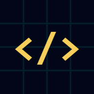

<div align="center">



# CodeQuest — Belajar Coding

**Petualangan coding gratis, tanpa akun, langsung dari browser dan HP.**

[**Buka CodeQuest**](https://fuckinsomnia.github.io/codequest/) · [**Lihat repository**](https://github.com/Fuckinsomnia/codequest)

`61 kursus` · `427 pelajaran` · `3 tingkat` · `5 editor runtime` · `PWA offline`

</div>

---

## Tentang CodeQuest

CodeQuest adalah platform belajar coding orisinal berbahasa Indonesia dengan alur **Learn → Practice → Build**. Proyek ini terinspirasi pendekatan [Codédex](https://www.codedex.io/), tetapi materi, ilustrasi, tampilan, dan implementasinya dibuat sendiri. CodeQuest **tidak berafiliasi dengan Codédex** dan bukan salinan kursus berbayar.

Semua materi dapat dipakai gratis tanpa login, komunitas, iklan, backend, API key, atau langganan. Kode dijalankan di perangkat pengguna, bukan dikirim ke server.

### Isi kurikulum

| Kategori | Jumlah |
| --- | ---: |
| Kursus | 61 |
| Pelajaran | 427 |
| Track/subjek | 23 |
| Kursus Pemula | 15 |
| Kursus Menengah / Intermediate | 23 |
| Kursus Expert | 23 |
| Latihan coding | 139 |
| Kuis konsep | 288 |
| Proyek terpandu | 6 |

Setiap track memiliki jalur Menengah dan Expert. Kursus Pemula, Menengah, dan Expert tetap dapat dibuka langsung; prasyarat hanya rekomendasi, bukan penguncian.

Rilis materi saat ini: **2026.11**.

## Fitur utama

- **Belajar bertahap** — konsep singkat, contoh, instruksi, petunjuk berjenjang, dan pembahasan.
- **Editor kode nyata** — Python, JavaScript, SQLite, HTML, dan CSS berjalan langsung di browser.
- **Validasi latihan** — output Python/JavaScript/SQL dan pemeriksaan tampilan HTML/CSS diperiksa otomatis.
- **Kuis konsep** — tersedia untuk bahasa atau topik yang belum memiliki runtime khusus.
- **Progres lokal** — XP, pelajaran selesai, streak harian, lencana bab, bookmark, catatan, dan draft kode tersimpan otomatis.
- **Sertifikat belajar mandiri** — terbuka setelah seluruh pelajaran dalam satu kursus selesai; dapat dicetak atau disimpan sebagai PDF.
- **Coding Challenges** — latihan tambahan dari bank soal yang tersedia.
- **Guided Projects** — enam proyek dengan langkah dan checklist penilaian mandiri.
- **30 Hari Coding** — tantangan membangun kebiasaan belajar harian.
- **Builds** — ruang membuat website dengan HTML, CSS, dan JavaScript, lengkap dengan live preview, penyimpanan lokal, dan unduhan HTML. Maksimal 30 proyek.
- **PWA** — dapat dipasang ke layar utama HP atau desktop tanpa APK, Play Store, atau Android Studio.
- **Offline** — materi, editor, font, ilustrasi ASCII, dan runtime Python/SQLite tersedia setelah persiapan awal selesai.
- **Tema gelap/terang** dan tampilan responsif untuk layar kecil.
- **Grafis ASCII art** — latar, peta, karakter, ikon aplikasi, serta 61 ilustrasi kursus dan 6 ilustrasi proyek yang unik per bidang dan level.
- **ASCII detail tinggi** — hero memakai ilustrasi ASCII pilihan pengguna; setiap track memakai foto realistis dengan ramp detail, warna asli, dan crop penuh (`contain`). Sejumlah track memakai metafora alam seperti tulip Keukenhof untuk CSS, tanah lapang hijau untuk HTML, hutan untuk JavaScript, laut dalam untuk SQL, dan sungai bercabang untuk Git.
- **Tanpa pelacakan aplikasi** — tidak ada akun, analytics aplikasi, atau iklan.

## Mulai menggunakan

1. Buka [CodeQuest](https://fuckinsomnia.github.io/codequest/).
2. Pilih kursus dari halaman **Learn**.
3. Buka pelajaran pertama, baca instruksi, lalu kerjakan latihan.
4. Klik **Run** untuk mencoba kode atau **Submit answer** untuk mengirim jawaban.
5. Pantau XP, lencana, dan streak di **Petualanganku**.
6. Ekspor progres secara berkala dari **Petualanganku → Ekspor progres**.

Tidak perlu mendaftar sebelum belajar.

## Pasang di HP dan gunakan offline

### Android — Chrome atau Edge

1. Buka alamat HTTPS CodeQuest.
2. Tekan ikon **Aplikasi HP dan offline** di header, atau menu browser.
3. Pilih **Pasang aplikasi / Tambahkan ke layar utama**.
4. Tunggu status **Siap digunakan offline**.

### iPhone atau iPad — Safari

1. Buka alamat HTTPS CodeQuest di Safari.
2. Ketuk tombol **Bagikan**.
3. Pilih **Tambahkan ke Layar Utama**.
4. Buka CodeQuest dari ikon layar utama dan tunggu persiapan offline selesai.

### Desktop

Gunakan menu Chrome/Edge dan pilih **Install CodeQuest** atau **Add to Dock / Install app**, sesuai browser dan sistem operasi.

### Catatan offline

- Pemasangan dan service worker memerlukan **HTTPS** atau `localhost`.
- Persiapan pertama mengunduh sekitar **18 MB**, tergantung browser dan kondisi penyimpanan.
- Biarkan halaman terbuka sampai status offline siap. Setelah itu, aplikasi dapat dibuka kembali tanpa internet.
- Pembaruan materi diperiksa saat aplikasi terbuka online. Jika tersedia, konfirmasi pembaruan melalui dialog CodeQuest.
- Simpan pekerjaan Builds yang sedang diedit sebelum menerapkan pembaruan.
- Cache offline bukan pengganti cadangan progres. Menghapus data situs, mode privat, atau menghapus aplikasi dapat menghilangkan data lokal.

## Progres dan privasi

Progres disimpan menggunakan:

- **IndexedDB** sebagai penyimpanan utama.
- **localStorage** sebagai cadangan lokal dan jalur migrasi.
- Kunci penyimpanan lama: `codequest-v1`.
- Database IndexedDB: `codequest`, object store `progress`.

Data mencakup pelajaran selesai, draft kode, catatan, bookmark, nama, avatar, aktivitas harian, checklist proyek, dan Builds.

### Pindah perangkat atau browser

1. Buka **Petualanganku** pada perangkat lama.
2. Klik **Ekspor progres** untuk mengunduh berkas `.json`.
3. Buka CodeQuest pada perangkat baru.
4. Klik **Impor**, pilih berkas tersebut, lalu konfirmasi penggantian data.

Berkas impor divalidasi dan dibatasi ukurannya. ID pelajaran yang sudah tidak ada akan diabaikan.

### Batasan penyimpanan

- Progres **tidak sinkron otomatis** antarperangkat.
- `localhost`, alamat LAN, dan GitHub Pages adalah origin berbeda; progres tidak otomatis berpindah di antara alamat tersebut.
- Pembaruan aplikasi mempertahankan data lokal, tetapi penghapusan data browser dapat menghapusnya.
- Tombol **Lindungi penyimpanan progres** dapat meminta penyimpanan persisten jika browser mendukungnya. Persetujuan browser tidak dijamin.
- CodeQuest tidak mengenkripsi atau menyinkronkan data ke cloud. Gunakan ekspor JSON sebagai cadangan.

## Menjalankan secara lokal

### Prasyarat

- Node.js **22 LTS** dan npm.
- Browser modern berbasis Chromium.
- Google Chrome diperlukan untuk suite browser/PWA saat menggunakan konfigurasi tes bawaan Windows.

Tidak diperlukan Python, database, akun, API key, atau koneksi ke runtime CDN. Pyodide dan SQLite disalin dari dependensi npm ke aset lokal saat instalasi.

### Instalasi

```bash
git clone https://github.com/Fuckinsomnia/codequest.git
cd codequest
npm ci
```

`postinstall` menjalankan `setup-runtime.mjs` untuk menyalin runtime ke:

```text
public/runtime/python/
public/runtime/sql/
```

Folder tersebut dihasilkan otomatis dan tidak perlu di-commit.

### Mode pengembangan

```bash
npm run dev
```

Buka `http://127.0.0.1:5173`.

Service worker dan pemasangan PWA hanya aktif pada build produksi. Mode pengembangan tetap dapat dipakai untuk mengembangkan antarmuka dan editor.

### Build produksi

```bash
npm run build
npm run preview
```

Buka `http://127.0.0.1:5174`.

Hasil build berada di `dist/`.

### Pintasan Windows

Setelah `npm ci`, klik dua kali `start-codequest.cmd`. Skrip akan:

1. Memeriksa Node.js dan dependensi.
2. Membangun aplikasi.
3. Menjalankan preview di `http://localhost:5174`.
4. Menampilkan alamat jaringan untuk perangkat di Wi-Fi yang sama.

Pemasangan PWA di HP melalui alamat LAN memerlukan HTTPS yang dipercaya browser. Untuk penggunaan normal di HP, gunakan alamat GitHub Pages.

## Struktur proyek

```text
codequest/
├── .github/workflows/
│   └── pages.yml              # Build, tes unit, dan deploy GitHub Pages
├── public/
│   ├── icon-*.png             # Ikon PWA ASCII
│   ├── favicon.svg           # Favicon ASCII
│   ├── manifest.webmanifest   # Manifest aplikasi
│   └── runner.js              # Web Worker runtime kode
├── src/
│   ├── data/                  # Kursus, pelajaran, kuis, dan proyek
│   ├── App.jsx                # Route, katalog, progres, Builds, dan halaman utama
│   ├── Lesson.jsx             # Latihan, editor, kuis, catatan, dan umpan balik
│   ├── Practice.jsx           # Coding Challenges
│   ├── Pwa.jsx                # Instalasi, status offline, update, dan penyimpanan
│   ├── components.jsx         # Komponen UI bersama dan ilustrasi ASCII
│   ├── ascii-art.js           # Ilustrasi unik per kursus dan proyek
│   ├── RealisticAscii.jsx     # Render foto menjadi karakter ASCII berwarna
│   ├── ascii.css              # Tema grafis ASCII
│   ├── engine.js              # Eksekusi kode dan preview HTML/CSS
│   ├── store.js               # Validasi, persistensi, streak, dan ekspor
│   ├── main.jsx               # Entry point React
│   └── *.css                  # Gaya aplikasi
├── tests/
│   ├── content.test.mjs       # Integritas kurikulum dan progres
│   ├── browser.mjs            # Regresi editor, UI, materi, dan mobile
│   └── pwa.mjs                # Instalasi, offline, IndexedDB, cache, dan update
├── index.html
├── package.json
├── package-lock.json
├── service-worker.js          # Template precache offline
├── setup-runtime.mjs          # Menyalin runtime Pyodide/SQLite
├── start-codequest.cmd        # Launcher Windows
└── vite.config.js             # Build Vite dan generator service worker
```

## Memperbarui materi

Semua kurikulum berada di `src/data/`.

1. Edit kursus atau pelajaran yang ingin diperbarui.
2. Pertahankan `id` kursus dan pelajaran lama agar progres pengguna tetap valid.
3. Untuk kursus baru, gunakan `trackId` yang sesuai agar navigasi level bekerja.
4. Perbarui `contentRelease.version` dan `contentRelease.date` di `src/data/index.js` jika merilis materi baru.
5. Jalankan pengujian.
6. Build dan publikasikan.

Contoh lokasi pengembangan:

- Kursus dasar: `src/data/python.js`, `src/data/core-courses.js`, `src/data/advanced-courses.js`.
- Jalur Menengah/Expert inti dan web: `src/data/level-core.js`, `src/data/level-web.js`.
- Data/AI: `src/data/level-data-ai.js`.
- Creative/Web: `src/data/level-creative-web.js`.
- Sistem: `src/data/level-systems.js`.
- Game: `src/data/phaser.js`.
- Proyek terpandu: `src/data/projects.js`.

Materi **tidak diperbarui otomatis dari sumber eksternal**. Pembaruan dilakukan manual melalui perubahan file, build, dan deploy.

## Pengujian

### Tes unit dan integritas data

```bash
npm test
```

Menguji jumlah serta keunikan kursus/pelajaran, level, ID lama, struktur kuis, validasi impor, XP, dan streak. Tes ini tidak memerlukan server.

### Tes browser

Terminal pertama:

```bash
npm run dev
```

Terminal kedua:

```bash
npm run test:browser
```

Suite memeriksa editor Python/JavaScript/SQLite, HTML/CSS, kuis, progres, catatan, Builds, proyek, sertifikat, tema, mobile 320/390 px, dan seluruh layout kursus.

Konfigurasi bawaan memakai Chrome di:

```text
C:/Program Files/Google/Chrome/Application/chrome.exe
```

Jika Chrome berada di lokasi lain atau tes dijalankan di OS lain, sesuaikan `executablePath` di `tests/browser.mjs` dan `tests/pwa.mjs`.

### Tes PWA

```bash
npm run test:pwa
```

Skrip membangun `dist/`, menjalankan server lokal sementara, lalu menguji manifest, installability, cache runtime, migrasi IndexedDB, editor offline, pembaruan service worker, quota penyimpanan, Builds, catatan, dan preservasi cache lain.

Untuk menguji base path GitHub Pages:

```bash
npm run build -- --outDir=dist-pages --base=/codequest/
```

Kemudian pada Git Bash:

```bash
PWA_BASE=/codequest/ PWA_DIST=dist-pages node tests/pwa.mjs
```

Pada PowerShell, set `PWA_BASE` dan `PWA_DIST` lebih dahulu, lalu jalankan `node tests/pwa.mjs`.

## Deployment GitHub Pages

Repository ini menggunakan GitHub Actions di `.github/workflows/pages.yml`.

Alur otomatis pada push ke `main`:

1. Checkout repository.
2. Setup Node.js 22.
3. Jalankan `npm ci`.
4. Jalankan `npm test`.
5. Build dengan base path dari konfigurasi Pages.
6. Unggah artifact `dist`.
7. Deploy melalui GitHub Pages.

Untuk menggunakan repository ini sebagai fork:

1. Buka **Settings → Pages**.
2. Pilih **GitHub Actions** sebagai sumber.
3. Sesuaikan nama repository atau alamat deployment.
4. Push perubahan ke `main` atau jalankan workflow secara manual.

Build lokal untuk alamat subdirektori dapat dilakukan dengan:

```bash
npm run build -- --base=/nama-repository/
```

## Arsitektur singkat

- **React 19 + Vite 6** untuk antarmuka dan build.
- **Hash routing** agar navigasi berjalan pada hosting statis tanpa konfigurasi rewrite.
- **CodeMirror 6** untuk editor kode.
- **Pyodide 0.27.7** untuk Python di Web Worker.
- **sql.js 1.13.0** untuk SQLite di Web Worker.
- **iframe sandbox** dengan `allow-scripts` untuk preview HTML/CSS dan Builds.
- **IndexedDB + localStorage** untuk progres.
- **Service worker** untuk precache dan update offline.
- **Manifest PWA** untuk instalasi, ikon, dan shortcut.
- **Font lokal** Press Start 2P dan Mulish; tidak memerlukan Google Fonts.
- **GitHub Pages** sebagai hosting statis.

Plugin `offlineBundle` di `vite.config.js` mengumpulkan aset publik dan hasil bundle, menghitung versi cache, lalu menyuntikkan daftar precache ke `sw.js`.

### Sumber aset realistis

- Setiap track memakai satu foto realistis dari Pexels. Daftar lengkap file, fokus crop, dan tautan sumber ada di `src/ascii-photos.js`, digunakan sesuai [Pexels License](https://www.pexels.com/license/).
- Hero ASCII: ilustrasi pemandangan detail tinggi yang disediakan pengguna, digunakan sebagai aset lokal `public/hero-ascii-user.jpg`.

Foto menjadi basis bentuk dan warna. Lapisan karakter ASCII detail tinggi digambar di atasnya sehingga subjek tetap terbaca, tetapi tampil sebagai ASCII berwarna asli.

Referensi renderer: [python-ascii_magic](https://github.com/LeandroBarone/python-ascii_magic) (MIT). CodeQuest mengadaptasi konsep ramp kepadatan karakter, koreksi gamma 2.2, dan boost kanal warna, dengan implementasi canvas sendiri.

## Keamanan dan batasan editor

- Kode pengguna dijalankan di browser melalui Web Worker atau iframe sandbox.
- Preview Builds dan HTML/CSS tidak diberi akses jaringan maupun penyimpanan browser di dalam sandbox.
- Eksekusi kode memiliki batas waktu sekitar lima detik dan tombol **Stop**.
- Runtime Python memerlukan dukungan WebAssembly.
- Latihan output membuktikan kecocokan hasil, bukan seluruh properti algoritma seperti kompleksitas waktu atau penggunaan memori.
- Kursus konsep menggunakan kuis; tidak semua bahasa memiliki compiler di browser.
- Sertifikat CodeQuest adalah penghargaan belajar mandiri, bukan sertifikat resmi Codédex atau bukti akreditasi.

## Troubleshooting

### `npm` tidak dikenali

Instal Node.js LTS, tutup lalu buka kembali terminal, dan pastikan folder Node.js berada di `PATH`.

### Runtime Python/SQLite tidak ditemukan

Jalankan ulang instalasi:

```bash
npm ci
```

Atau salin ulang runtime:

```bash
npm run postinstall
```

Periksa keberadaan `public/runtime/python/` dan `public/runtime/sql/`.

### PWA belum siap offline

- Gunakan build produksi, bukan `npm run dev`.
- Buka melalui HTTPS atau `localhost`.
- Tunggu unduhan awal selesai.
- Muat ulang halaman dan periksa dialog **Aplikasi HP dan offline**.
- Pastikan browser memiliki ruang penyimpanan.

### Progres tidak terlihat

- Pastikan membuka origin yang sama dengan sebelumnya.
- Jangan menggunakan mode privat jika ingin menyimpan progres.
- Coba impor berkas ekspor JSON melalui **Petualanganku → Impor**.
- Menghapus data situs akan menghapus progres dan cache offline.

### Materi lama masih tampil

Buka CodeQuest saat online. Service worker versi baru sekarang aktif otomatis dan halaman dimuat ulang tanpa menunggu konfirmasi. Progres tersimpan tetap dipertahankan. Jika browser masih menahan versi lama, tutup seluruh tab CodeQuest lalu buka kembali; jangan menghapus data situs sebelum mengekspor progres.

### Tes browser gagal menemukan Chrome

Sesuaikan path `executablePath` Chrome di kedua berkas tes, atau jalankan pada Windows dengan lokasi instalasi Chrome bawaan.

### Peringatan chunk besar saat build

Vite dapat menampilkan peringatan ukuran chunk, terutama karena editor dan runtime. Peringatan ini bukan kegagalan build selama proses build selesai.

## Kontribusi

1. Fork repository.
2. Buat branch untuk perubahan.
3. Pertahankan ID materi lama dan tambahkan tes untuk perubahan perilaku.
4. Jalankan `npm test` serta tes browser/PWA yang relevan.
5. Buat pull request dengan penjelasan perubahan.

Jangan memasukkan kredensial, token, data progres pribadi, folder `node_modules`, `dist`, atau runtime hasil generate ke commit.

## Status dan lisensi

Proyek berjalan sepenuhnya di browser dengan hosting statis. Belum ada sinkronisasi cloud, backend, atau pembaruan materi otomatis.

Lisensi penggunaan ulang **belum ditentukan**. Gratis digunakan tidak otomatis berarti proyek ini dirilis sebagai open source dengan lisensi tertentu; periksa dan tetapkan lisensi sebelum melakukan distribusi ulang skala luas.
